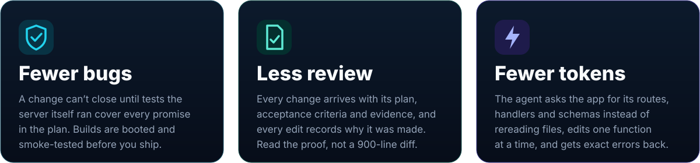
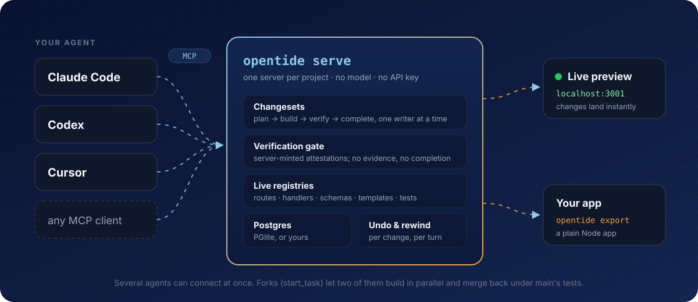

<p align="center">
  
</p>

<p align="center">
  <a href="https://github.com/opentideai/opentide/actions/workflows/ci.yml"></a>
  <a href="https://github.com/opentideai/opentide/releases/latest"></a>
  
  <a href="LICENSE"></a>
</p>

<h3 align="center">The agent-native web framework</h3>

<p align="center">
  <b><a href="https://opentide.ai">opentide.ai</a></b> ·
  <b><a href="#quick-start">Quick start</a></b> ·
  <b><a href="#connect-your-agent">Connect your agent</a></b> ·
  <b><a href="#what-you-get">What you get</a></b> ·
  <b><a href="#how-it-works">How it works</a></b> ·
  <b><a href="#ship-it">Ship it</a></b> ·
  <b><a href="#docs">Docs</a></b>
</p>

---

**You asked your agent for a feature. It said "done". Now you're reading 900
lines of diff, running the tests it didn't run, and finding the bug it didn't
mention.**

OpenTide is the agent-native web framework that fixes that. Connect any coding
agent that speaks MCP (Claude Code, Codex, Cursor, Windsurf and the rest) and it
builds inside a running app that keeps it honest. Apps are TypeScript today;
Python support is coming next.

- **Fewer bugs.** A change can't be marked done until tests the server ran
  itself cover every point in the plan.
- **Fewer review rounds.** Every change comes with its plan, its acceptance
  criteria and its evidence. Check the proof instead of reverse-engineering the
  diff.
- **Spend fewer tokens.** The agent asks the app what exists instead of
  rereading your codebase, edits one function at a time, and gets errors that
  say exactly what to fix.
- **Own the result.** One command exports a plain Node app. No platform fee, no
  lock-in, no API key. Bring the agent you already pay for.

<p align="center">
  
</p>

## Quick start

The installer brings everything it needs and puts `opentide` on your PATH. You
only need `curl`. Open a new terminal after installing.

```sh
curl -fsSL https://github.com/opentideai/opentide/releases/latest/download/install.sh | sh
opentide scaffold ~/apps "Todo App" && cd ~/apps/todo-app
claude mcp add opentide -- opentide mcp
claude
```

Ask for something real:

> _Add a todos API with create, list and complete, backed by a table, with
> tests._

<p align="center">
  
</p>

What you get back isn't a summary to take on faith. It's a finished change with
a plan, passing tests the server witnessed, and the evidence linked to each
acceptance criterion, already saved to files you commit.

## Connect your agent

OpenTide works with any coding agent that speaks MCP. Each config below starts a
small stdio bridge, which attaches to the project's server or starts one if none
is running.

**Claude Code** (registers it for that project's directory)

```sh
cd ~/apps/todo-app && claude mcp add opentide -- opentide mcp
```

**Claude Code plugin** (the server in every OpenTide project, plus
`/opentide:start`, `/opentide:change`, `/opentide:land` and `/opentide:recover`)

```sh
claude plugin install opentide --marketplace opentideai/opentide
```

Needs Claude Code 2.1.275 or later. Older versions take two steps inside a
session: `/plugin marketplace add opentideai/opentide`, then
`/plugin install opentide@opentide`. Outside an OpenTide project the server
still connects, with no tools.

**Codex** (the CLI and the IDE extension share `~/.codex/config.toml`)

```sh
codex mcp add opentide -- opentide mcp --project ~/apps/todo-app
```

**Claude Desktop**: download
[`opentide.mcpb`](https://github.com/opentideai/opentide/releases/latest/download/opentide.mcpb),
double-click it, and pick your project folder when Desktop asks. It runs the
OpenTide you installed above; if that's missing, ask Claude to use OpenTide and
it tells you how to install it.

**Cursor** (paste into `.cursor/mcp.json`)

```sh
opentide mcp --print-config cursor --project ~/apps/todo-app
```

**Any other MCP client** (Windsurf, VS Code, Zed, Cline, your own): add a stdio
server with

- command: `opentide`, or the full path `~/.opentide/bin/opentide` if the client
  doesn't inherit your shell's PATH
- args: `mcp --project /absolute/path/to/your/app`

Clients that only speak HTTP can connect to `opentide serve` directly; see
[docs/mcp-connect.md](docs/mcp-connect.md) for the HTTP transport, tokens, and
what the agent is told on connect.

## What you get

###  Fewer bugs

The agent can't call a change finished on its own say-so.

- `complete_changeset` refuses until every acceptance criterion is backed by
  evidence.
- Evidence must cite **attestations** that the server mints when it runs
  `run_tests`, `check_export_types` or `verify_formal_specs`. Edit the code
  afterwards and the attestation goes stale.
- Before an agent edits something, `search_changes` tells it why the code is the
  way it is, so it doesn't undo a fix.
- `opentide build` boots the build and smoke-tests its routes before you ship.

###  Fewer review rounds

Every change is a **changeset**: a title, a plan with steps, acceptance
criteria, a verification plan, and the evidence that it was met.

- Read what was intended and what was proven, not a wall of diff.
- Every edit records its rationale, searchable later with `search_changes` and
  `get_change`.
- `project_status` gives one verdict on the project's health, and
  `get_changeset_context` shows a change's plan and progress.
- The gate runs advisory, graduated or strict. You decide how hard it bites.

###  Spend fewer tokens

Most agent tokens go on rediscovering your code. Here the agent asks.

- `list_routes`, `list_handlers` and `list_schemas` return the app's structure
  directly, with no file crawling or grep loops.
- Edits are per entity: one handler, one route, one schema. The agent doesn't
  rewrite whole files to change one function.
- Errors are structured and specific. A mistyped argument comes back as
  `INVALID_ARGUMENTS` naming the right key, so it's fixed on the first retry.
- Claude Code loads OpenTide's tools on demand, so 109 tools don't sit in every
  prompt.

###  See it working right away

No build-and-restart loop between "written" and "running".

- A handler is serving the moment it's defined. A route is on the preview port
  the moment it's registered. A schema change has run the moment it lands.
- The agent checks its own UI work with browser screenshots and scripted UI
  tests (`screenshot_app`, `test_app`) against the running app.
- Open `localhost` and click around while it's still working.

###  Never lose work

Agents go off the rails. Getting back is one call.

- `undo_change` and `undo_turn` step back one change or a whole agent turn.
- Abandoning a changeset **rewinds** the code, schema and files to where they
  started, and your app's data stays.
- Agent crashed, restarted, or you ran `/clear` mid-change? The next session
  calls `adopt_changeset` and carries on with the plan and progress intact.
- `take_snapshot` and `restore_snapshot` for anything bigger.

###  Go faster in parallel

Two agents, one project, no merge hell.

- `start_task` forks the project for a second agent, with its own server and
  preview.
- `merge_task` replays the fork onto main and completes it only if main's own
  tests pass.
- If two forks change the same thing, the second merge is refused with the
  conflicts named. No silent overwrites.
- One writer at a time on main, enforced, so agents can't trample each other.

###  Own the result

- `opentide export` writes a standalone Node app, and `opentide build` makes a
  deployable one.
- Apache-2.0, runs on your machine, uses your Postgres (PGlite locally, or any
  Postgres via `OPENTIDE_DB_URL`).
- No model inside and no API key. It works with the agent subscription you
  already have.

###  Safe by default

- The server listens on loopback only and needs a per-project bearer token.
- Secrets go through `define_secret`, never into code.
- `check_package_security` checks installed packages for known vulnerabilities
  and deprecations, with upgrade advice.
- Projects live in Git, and machine-local state stays out of commits. See
  [docs/project-storage.md](docs/project-storage.md).

## How it works

<p align="center">
  
</p>

One `opentide serve` per project holds the app. Its routes, handlers, schemas,
templates, migrations and tests live in a project database the server owns, and
they hot-swap the moment they're defined. Agents drive it through **109 MCP
tools**. Any number can connect; one at a time holds the pen.

## See it running

```sh
opentide serve --project ~/apps/todo-app --app-port 3001
open http://localhost:3001
```

To pin the port for every start, including the ones the bridge makes, set
`"previewPort": 3001` in the project's `opentide.json`.

## Ship it

```sh
opentide export --project ~/apps/todo-app --out ./todo-export
cd todo-export && npm install && npm start
```

You get a standalone Node app (Node 24+): an entry point, a router, the handlers
with their request validation, a schema seed and generated API docs.
`opentide build` writes the same into the project's `dist/`. Deploy it anywhere
Node runs.

## Good to know

- **Work lives in memory until it's flushed.** `complete_changeset` flushes it
  to `.opentide/state/`, which you commit. If it reports `stateFlushed: false`,
  the work exists only in the running server.
- **Platforms.** macOS and Linux run the full test suite and the install smoke
  in CI on every push. On Windows, use WSL; native Windows hasn't been run.
- **It's 0.1.** Expect rough edges, and please
  [file them](https://github.com/opentideai/opentide/issues).

## Docs

| Doc                                               | What's in it                                                |
| ------------------------------------------------- | ----------------------------------------------------------- |
| [opentide CLI](docs/opentide-cli.md)              | Install, every command and flag, releases, CI               |
| [Connecting agents over MCP](docs/mcp-connect.md) | Claude Code, Codex, Cursor, HTTP, tokens, changesets, tasks |
| [LSP for editors](docs/lsp-connect.md)            | Neovim, Zed, capabilities, writing through LSP              |
| [Project storage](docs/project-storage.md)        | What's in a project, what to commit, what stays local       |

## Tide

Tide, the IDE reinvented for AI, is built on OpenTide and coming soon: chat with
an agent on one side and your running app on the other, with every change
verified before it counts as done. Follow it at
[opentide.ai](https://opentide.ai).

## License

[Apache-2.0](LICENSE). See [NOTICE](NOTICE).
